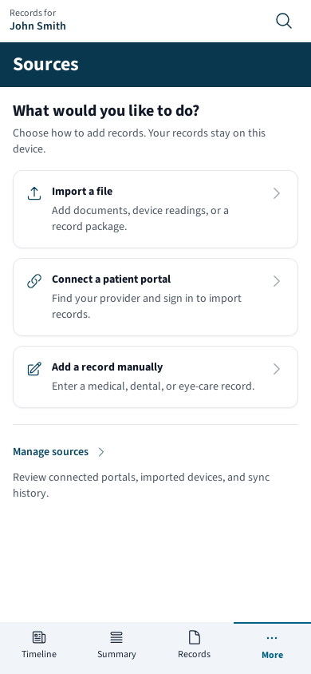
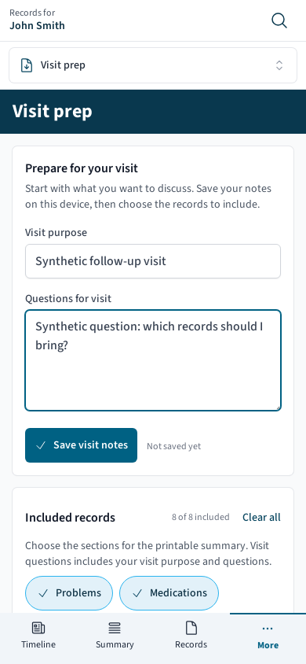
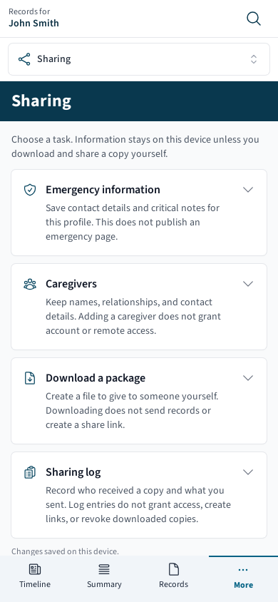
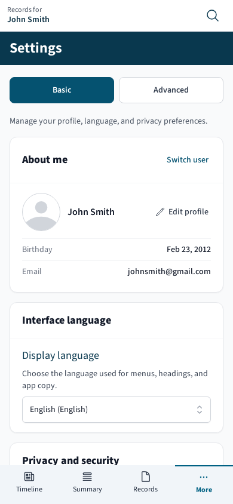
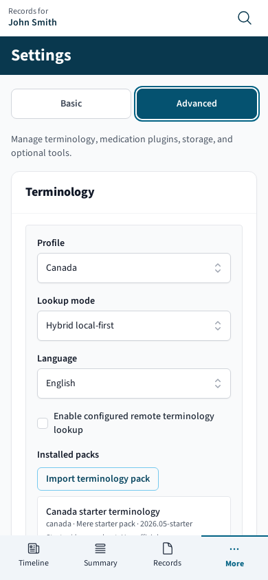
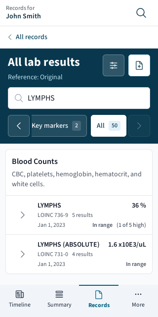
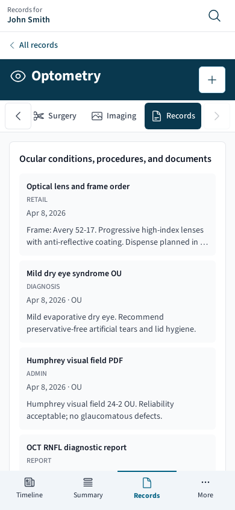
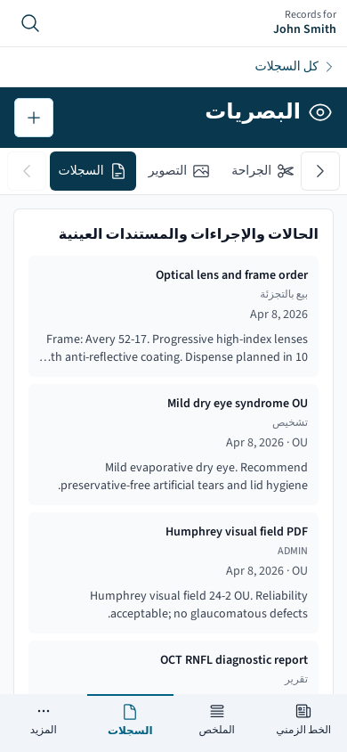

# Mobile design pass — 8 November 2026

## Outcome and review status

This follow-up implements the five organization changes identified in the [earlier mobile review](../mobile-review-2026-11-08/README.md): Sources, Visit prep, Sharing, Settings, and compact Labs/specialty navigation. The central reading journey from that review remains the foundation.

The implementation is published in [draft PR #20](https://github.com/ahzs645/merer-medical/pull/20), at application commit [`28d872c`](https://github.com/ahzs645/merer-medical/commit/28d872c87f4e193979ca85edfa1d6f37e5b88964), tree `09f6982e4425facb050e937cd0b83d83c6494c86`. The PR has not been merged or deployed.

**Verified result:** 91 focused tests across 15 suites and both application and browser-test TypeScript checks passed locally. The production build and **all 45 mobile browser cases passed, with no retries or failures**, in the [final mobile job](https://github.com/ahzs645/merer-medical/actions/runs/42531040793/job/128885126014). The browser run took 2.6 minutes. The earlier review's 24-case result concerns the preceding revision; those journeys were rerun as part of these 45 cases. The later evidence commit changes only review documents and synthetic screenshots.

All test records, notes, generated files, and screenshots are synthetic.

## What changes for the reader

### Sources: choose the job before setup

Sources opens with **Import a file**, **Connect a patient portal**, and **Add a record manually**. Import shows file choices; portal connection shows provider lookup and integration readiness; manual entry offers medical, dental, and optometry forms. “Manage sources” opens connection administration separately.

The selected task uses `?task=`, so Back can recover it. Manual-entry and device-import cancellation return to that task. Task changes focus their heading without stealing focus from an open package dialog. Existing package-link handling and portal authorization preflight remain in place.

### Visit prep: preparation comes first

Visit purpose and questions now lead the page. Notes are saved explicitly for the selected profile, with saved/error feedback. Previously saved question-only notes remain readable. Closing or changing the preview does not clear the editor.

Included sections follow the notes. Turning off “Visit questions” excludes both purpose and questions from the summary and displays an explanation; it leaves the notes in the editor. Preview starts closed and mounts one sandboxed packet frame only when requested. The optional local-file preview shares that space. A second long rendered packet no longer precedes the questions on screen.

The download section uses current editor values and selected summary sections. Summary generation is disabled while the current profile's records are loading or have failed to load.

### Sharing: distinguish actions and outcomes

Each section explains the result before revealing its controls:

- **Emergency information** stores contacts and critical notes for the profile; it does not publish an emergency page.
- **Caregivers** keeps contact information; adding a person does not grant remote or account access.
- **Download a package** creates a file the user can deliver separately. Its default scope is the selected profile, with an explicit all-profiles option.
- **Sharing log** records who received a copy and what was sent. Its review date does not expire a downloaded file, and removing an entry does not revoke a copy.

Collapsing these sections preserves drafts. Sharing changes are saved in edit order, with visible saving/failure feedback. Exports wait for queued sharing saves before building their package.

### Settings: keep everyday preferences together

Basic contains profile management, interface language, privacy/security, and About Mere. Advanced contains terminology, medication safety plugins, data administration, and optional experimental/developer tools. The toggles that expose developer and experimental configuration moved out of About Mere.

The active level uses `?level=advanced` and survives Back. Existing links such as `#about-me`, `#use_proxy`, `#data`, `#terminology`, and `#experimental` open the appropriate level. Advanced initializes on first use; visited panels stay mounted to preserve unsaved inputs. Profile switching/editing retain their controls.

Level changes and section links scroll only the Settings content, keeping the heading and profile strip in place. Section offsets are calculated within that content scroller. The outer app shell uses `overflow: clip` where supported so native fragment navigation cannot shift it; intentional scrolling remains inside the main/content regions, with the previous clipping behavior retained as a fallback for older engines.

### Headers and horizontal choices

Labs keeps the selected reference visible above the list and moves its selector and record-coverage details into “Lab options.” Changing the reference leaves the dialog open and preserves the search. Specialty headers use compact counts on small/short screens.

Scrollable choices have visible 44-pixel previous/more buttons beside the row. Selected or keyboard-focused items are revealed within the row. Direction changes and resize are remeasured; arrows disappear when all choices fit. Movement respects reduced motion and RTL direction. Sideways scrolling no longer overwrites the vertical list position used by Back. A remembered offset of zero also restores correctly when query-driven tasks reuse a scroller.

Labs and Visit prep allow vertical scrolling around their headers when enlarged text consumes a short viewport, keeping the content reachable. The phone identity strip reserves a fixed 44-pixel Search icon button and gives the remaining width to the selected person's name. Long names may use two lines; the complete name remains in the profile link's accessible label and the name's title. The tool picker also lets its current tool name wrap. Enlarged-text browser assertions target the actual visit question editor and lab result title, so an intersecting outer card cannot mask inaccessible content.

## Summary files and record packages have different scopes

| Output                  | Contents and behavior                                                                                                                                                                                                                             |
| ----------------------- | ------------------------------------------------------------------------------------------------------------------------------------------------------------------------------------------------------------------------------------------------- |
| HTML / Markdown summary | Current visit notes and the selected summary sections. The questions switch controls inclusion of purpose and questions. Downloading does not send the file.                                                                                      |
| Print / PDF summary     | The selected summary rendered in normal document flow outside the fixed-height application shell. Printing does not require opening the screen preview.                                                                                           |
| Visit prep `.emrpkg`    | The selected profile's records and stored workflow notes, with attachment/audit/password options. Summary section choices do not filter this package; it is not restricted to one visit. Visit purpose/questions belong to the summary downloads. |
| Sharing `.emrpkg`       | Selected-profile scope by default, or an explicit all-profiles export, with its displayed inclusion options. No remote share link is created.                                                                                                     |

The print packet is a body-level portal. Print CSS hides the application shell, releases viewport-height/overflow restrictions, and avoids splitting individual list entries where possible. This addresses clipping caused by nested screen scrollers; it does not establish Safari's print/download behavior.

Profile/database ownership guards prevent a newly selected profile's name from being combined with an old packet. Late exports are ignored after profile changes, database replacement, navigation away, or an A → B → A round trip. A stale completion cannot offer a download or clear a newer export's busy state. Failures retain current settings for retry.

## Verification and reproduction

| Check                              | Current evidence                                                                                                                                                                                    |
| ---------------------------------- | --------------------------------------------------------------------------------------------------------------------------------------------------------------------------------------------------- |
| Focused unit/component regressions | **91 passed / 15 suites**: task navigation, drafts, section links, summary inclusion/escaping, profile ownership, export races, scroller direction/resize, and vertical restoration including zero. |
| Application and E2E TypeScript     | **Both passed.**                                                                                                                                                                                    |
| Production Nx web build            | **Passed in CI at the application revision above.**                                                                                                                                                 |
| Expanded production mobile suite   | **45 passed in 2.6 minutes, no retries or failures**: eight existing and seven new journeys at each of three viewports.                                                                             |
| Local automated Chromium           | Could not start because the environment denied a required browser socket; this was not an application assertion failure.                                                                            |

The separate API/full-stack job is not included in these passing results; it had not completed at this verification checkpoint. Its previously reported startup/readiness investigation remains separate from this design pass.

The browser configuration uses **320×640, 390×844, and 844×390**. The 390px project uses normal animation; the others use reduced motion. New assertions cover task return, saved notes after reload, one optional preview, downloaded HTML contents, print media and a generated Chromium PDF, Sharing drafts/log semantics, Settings Back/deep links without moving the shell, reference changes, English/Arabic specialty navigation, and doubled interface text.

The print test checks shell exclusion, visible packet content, document overflow, and the PDF signature. All **five pages** of the synthetic Chromium PDF from the earlier run were also visually inspected: the notes and record sections were readable, with no app shell or visible clipping. The HTML assertion reads the downloaded file and verifies excluded notes are absent. This evidence does not certify every pagination case or Safari export behavior.

Use the repository's Node/npm versions, initialized submodules, and locked dependencies:

```sh
npm exec tsc -- --noEmit -p apps/web/tsconfig.app.json
npm exec tsc -- --noEmit --module NodeNext -p apps/web-e2e/tsconfig.e2e.json
npm exec nx -- build web --configuration=production
npx playwright install --with-deps chromium
npx playwright test --config apps/web-e2e/playwright.mobile.config.ts
```

The configuration starts the production static preview automatically. `E2E_BASE_URL` selects an already-running build. Focused regression files live alongside the changed features, plus `HorizontalChoiceScroller.spec.tsx` and `useScrollRestoration.spec.tsx`. Run them through the web Jest configuration with `--runInBand`.

## Synthetic screenshot evidence

These eight captures come from the successful production run at the application commit above. Visual review confirmed readable task choices, the corrected Settings shell position, and an unobstructed Arabic capture. All records and visit notes shown are synthetic.

| Sources tasks, 390px                                                                | Visit prep, 390px                                                                                  |
| ----------------------------------------------------------------------------------- | -------------------------------------------------------------------------------------------------- |
|  |  |

| Sharing tasks, 390px                                                                   | Basic Settings, 390px                                                                               |
| -------------------------------------------------------------------------------------- | --------------------------------------------------------------------------------------------------- |
|  |  |

| Advanced Settings, 390px                                                                               | Labs, 320px                                                                                  |
| ------------------------------------------------------------------------------------------------------ | -------------------------------------------------------------------------------------------- |
|  |  |

| Optometry in English, 390px                                                                                  | Optometry in Arabic, 390px                                                                               |
| ------------------------------------------------------------------------------------------------------------ | -------------------------------------------------------------------------------------------------------- |
|  |  |

Additional enlarged-text evidence, scrolled to the question editor or lab title: [Visit prep at 320px](screenshots/visit-prep-enlarged-text-320.png) and [Labs at 390px](screenshots/labs-enlarged-text-390.png), each with the root font size doubled.

## Remaining limits

The Arabic checks concern translated navigation and RTL scrolling in the exercised specialty routes. Generated HTML packet headings and some existing shell copy, including “Records for,” remain English; this is not complete Arabic-language acceptance. Doubling the root font size exercises reflow but does not substitute for native OS text settings, browser zoom, VoiceOver/TalkBack, or physical keyboard testing.

Physical iPhone/Android behavior, Safari PDF/download handling, full screen-reader reading order, large-chart performance, external portal sign-in, and destructive replacement imports still need their own checks. Search remains based on record display names rather than attachment full text; some undated records still require category browsing. This organization pass does not resolve those separate limitations.
