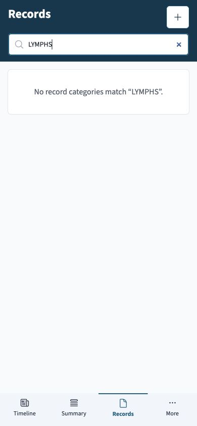

# Mobile workflow review — 8 November 2026

## Outcome

The mobile interface has useful functionality, but several core journeys do not follow the reader's intent. Opening a shared chart ends in source setup; a field labelled “Search records” only filters categories; searching Labs leaves a large glucose dashboard ahead of the matching tests; and some result links open a general list instead of the selected result. These are navigation and information-order problems, beyond visual styling.

This change makes the common journey more direct:

1. Open a package and land in Summary after a successful additive import.
2. See whose records are selected and reach Search from any portrait phone page.
3. Search stored record names or browse the existing categories.
4. Open the relevant detail and use Back to return to the previous search.
5. Expand charts and longer record groups when they are useful.

The review used the live application at baseline commit `80b50821`, narrow phone viewports, and the supplied example package. All committed evidence and automated fixtures use the application's synthetic `/demo` data or generated readings. No package URL, private record, or patient screenshot is included here.

## Findings and implemented changes

| Priority | What was observed                                                                                                                                                                                    | Effect on a phone                                                                                     | Change in this branch                                                                                                                                                                                                                                                                                                                                                        |
| -------- | ---------------------------------------------------------------------------------------------------------------------------------------------------------------------------------------------------- | ----------------------------------------------------------------------------------------------------- | ---------------------------------------------------------------------------------------------------------------------------------------------------------------------------------------------------------------------------------------------------------------------------------------------------------------------------------------------------------------------------- |
| High     | Successful shared-package import leaves Sources open. The notification totals profiles and connections together with clinical records.                                                               | The reader cannot readily tell where to start or reconcile the record count with the offer.           | Successful additive import opens Summary, with a clinical-record count and visible busy/error states. Closing an import prevents a later completion from changing the page. Existing replacement-import safeguards remain.                                                                                                                                                   |
| High     | Records' search matches category labels, so a clinical term can produce “No record categories match” despite existing records.                                                                       | Search appears broken. The reader must know the app's taxonomy first.                                 | Search now shows stored-record matches before matching categories. Labs open their grouped test history, documents open their detail, and other records open their anchored Timeline card. Query state survives Back.                                                                                                                                                        |
| High     | The selected profile and direct Search entry are available in the desktop rail but hidden behind secondary navigation on phones.                                                                     | There is no persistent confirmation of whose chart is open; searching takes an extra navigation step. | A compact portrait-phone strip identifies the selected profile and offers Search. The profile link opens profile management in Settings.                                                                                                                                                                                                                                     |
| High     | Labs renders the full imported CGM report before the laboratory list, even while a laboratory query is active. A matching test was more than 4,000 CSS pixels below the top in the reviewed example. | The search field appears ineffective because unrelated charts occupy the viewport.                    | A compact CGM summary starts collapsed. Charts mount only after “Show glucose report.” Active text search or a non-default lab filter hides the report. Clearing those controls restores the collapsed summary.                                                                                                                                                              |
| High     | Summary result highlights all open the Results hub. Mobile Results places list and detail in one long page without a stable selected-result URL.                                                     | Tapping a specific result does not visibly complete the intended action.                              | Highlights open the relevant destination. Report/imaging selections have a `?result=` URL; phones show the selected detail immediately and offer “All results.” Missing selections have an explicit message.                                                                                                                                                                 |
| High     | A stored JSON document displays a generic linked-document retrieval failure even though its file is present.                                                                                         | The user cannot distinguish an unsupported preview from missing data or a failed download.            | JSON and text previews decode the stored content correctly, including Unicode and FHIR inline base64 attachments. Preview formatting preserves JSON tokens; Open/Download retain original content. Missing, unsupported, and unreadable states are distinguished. Document lookup supports both metadata IDs and stored IDs.                                                 |
| Medium   | Timeline date cards enumerate long condition and medication lists before the expansion control.                                                                                                      | A single collapsed card occupies several screens.                                                     | Each category previews at most five entries and reports the remaining count. Medication types share one limit. Full records remain in the expanded view, including referrals that were previously absent there.                                                                                                                                                              |
| Medium   | Some record action chips are visually 32px high, with expanded invisible hit areas that overlap when rows wrap.                                                                                      | Adjacent actions are difficult to target reliably.                                                    | Record action chips have actual 44px phone targets. Document actions, source shortcuts, and Search also receive adequate physical targets.                                                                                                                                                                                                                                   |
| Medium   | More has no visible close action and no height limit. Search wastes substantial space above its panel.                                                                                               | Dismissal and reaching the last item are less obvious on short screens.                               | More has a visible Close button, a bounded scrollable sheet, and a Sharing link. Disabled transitions now finish cleanly under reduced-motion settings, preventing invisible dialog layers from blocking taps after closing a menu or form. Search uses the available phone height with a fixed header and scrolling results. The active primary tab exposes `aria-current`. |
| Medium   | Summary's “Allergies and conditions” tile only links to Conditions. Document titles truncate to one line.                                                                                            | Labels promise content the destination does not show; similar documents become hard to distinguish.   | Allergies and Conditions have separate labelled destinations. Document titles can use two lines on phones.                                                                                                                                                                                                                                                                   |

## Flow-by-flow assessment

### Shared chart → first useful screen

The supplied package imports successfully. The observed failure is the handoff after import, not proof that the package import itself is broken. Summary is a useful initial reading destination because it exposes the imported chart's major areas. Sources remains the place for adding and maintaining connections.

The import offer retains its origin, preview, encryption handling, and explicit import action. A dismissed slow import may finish its already-started database operation, but it must not unexpectedly replace a page the reader has subsequently opened.

### Summary → a specific record

Every labelled result should open what its label promises. A lab highlight opens that test's history, preserving the application's existing lab grouping. A document highlight opens the document. Reports and imaging results keep an exact selection in the URL. The mobile detail also starts at its heading instead of inheriting the previous list’s scroll position. The general “Open all results” link continues to open the list.

Summary's broader card arrangement and clinical prioritization are not redesigned here. The change corrects destinations and mobile list/detail behavior.

### Records → search → detail → Back

The category grid is useful for browsing, but it cannot be the only search target. Search now combines stored-record matches with category matches. Its scope is the existing record display name, with a two-character minimum and six recent usable hits. Search terms are literal, including parentheses and brackets. It is not full-text attachment search.

Each offered hit has a destination that can render it: a lab/document/result detail, a filtered device/provider list, or a dated Timeline card. Undated encounters and referrals use their lists. Unsupported internal resources and undated generic rows without a usable target are omitted; their supported category views remain available through browsing. The “Search Timeline” link searches dated Timeline records and does not claim to include every result from the hub.

Errors, loading, and an empty match set are separate states. The selected record destination is explicit rather than always opening a generic list. Timeline query/filter state is addressable so search handoffs also work when Timeline is already mounted.

### Labs and glucose history

The CGM dashboard is useful as an optional report. It should not occupy the first several screens when the task is finding a lab test. The compact report entry remains available when browsing all labs, and the full report remains available on demand. Laboratory formulas, reference standards, thresholds, and stored readings are not changed by this presentation work.

### Timeline

Shorter category previews make date groups easier to scan while preserving access to all records. This is a bounded improvement: a date containing many different categories can still be long. A later design pass could offer a compact count-based date summary or a sticky expansion action if real usage warrants it.

### Documents

The app has multiple attachment sources with different encodings. Manual text/XML/HTML imports store literal text; manual binary/JSON uploads and FHIR inline attachment data use base64. Legacy integrations can store either JSON text or base64-encoded file data. The shared decoder uses the attachment's connection to apply the original connector's storage rules even when older attachment metadata has no source fields. Cerner/Healow JSON and `application/*+xml` retain their decoded file bytes regardless of whether the contents are valid JSON or XML; Epic response text remains literal. When no encoding or connector is known, JSON base64 is inferred only if it decodes to valid UTF-8 JSON. Ordinary text and XML are not guessed to be base64. Other legacy binary formats retain their decoded download bytes even when a preview is unavailable.

Malformed JSON text remains readable with an explanation. When a legacy JSON string has no known encoding and cannot be validated after decoding, the original stored text is preserved. Unsupported stored formats have an honest “preview not available” state. PDF reading continues to open the browser's full-page viewer, where zoom, search, and print are practical on a phone.

### Add/edit record

The existing typed add-record destinations, sticky Save/Cancel controls, and dirty-form discard confirmation are retained. The acceptance journey checks returning to the originating category, including keeping or discarding an unsaved medication draft. No real medical record was created or edited for the review.

### Dental and optometry

The live 320px walkthrough confirmed that specialty navigation can scroll to its other sections, the dental tooth selector changes the displayed records, and the optometry prescription table fits the viewport. These areas are more internally coherent than the shared entry/search paths. Their stacked page headers still consume a substantial portion of a short phone screen. Complex scan manipulation, actual camera/file selection, and all specialty form variants need device-specific checks.

### Sources, Utilities, Sharing, and Settings

These routes are reachable and their examined top-level layouts fit the narrow viewport. There is still a hierarchy problem:

- Sources begins with portal/device setup before file import; a short “Import file / Connect portal / Add manually” action group would make the available tasks easier to choose.
- Visit prep presents both an embedded packet preview and a long rendered packet before the question editor. The next design pass should place visit questions and packet choices first, with one optional preview.
- Sharing combines emergency-profile editing, caregivers, package download, and share-log forms. Those tasks would be clearer as separate sections. The existing explanation correctly says that share-log entries do not themselves grant remote access.
- Settings mixes profile/language with terminology packs, medication plugins, storage, backups, and developer options. Basic preferences and advanced administration should have separate levels.

Small inline links between Export, Sharing, and Visit prep also wrapped across lines at 320px. They are now full-width labelled links with readable descriptions and actual 44px targets.

These broader reorganizations are recorded as follow-up design work. This branch concentrates on the demonstrated navigation, reading, target-size, and content-preview failures rather than moving every existing control at once.

## Validation and evidence

The final production build and application TypeScript check passed. All 276 focused tests across 25 suites passed, covering package import handoff/failure, record routing and literal search terms, exact result selection, CGM disclosure, Timeline previews, dialog transitions, and document decoding/download fidelity. Browser acceptance is pending the pull-request CI run; its result and evidence will be recorded here after it completes.

The dedicated mobile Playwright suite contains 24 cases (eight journeys across three viewports) and runs the production static preview with synthetic `/demo` data at 320×640, 390×844, and 844×390. The 390px project uses normal motion; the other two use reduced motion. It exercises navigation/dismissal, More-to-Search handoff, direct Search, record search/detail/Back (including a condition name with parentheses), Labs search/detail/Back, dirty-form cancellation, a generated LibreView import, exact Results selection/list/Back behavior, and a read-only category/settings route sweep. It saves screenshots and traces as CI artifacts.

Local automated Chromium could not start because this workspace denies a required browser socket. No browser assertions ran in that attempt. The pull-request workflow is the alternative execution environment; a test collection or successful build is not counted as a browser pass.

Baseline evidence uses the live synthetic demo:



### Remaining device checks

The automated viewports do not establish physical iOS/Android keyboard behavior, Safari PDF/download handling, VoiceOver/TalkBack quality, browser text enlargement, or performance of a large imported chart on a lower-memory phone. Those are release checks, not claims made by this review. Portal authorization, destructive replacement imports, and sharing a real package were not exercised.

### Reproduce

Use the repository's Node version and initialize its required submodules, then install the locked dependencies. Build the production web app and run the dedicated suite:

```sh
npm exec nx -- build web --configuration=production
npx playwright install --with-deps chromium
npx playwright test --config apps/web-e2e/playwright.mobile.config.ts
```

The mobile configuration starts `npm run preview:web:local` itself. `E2E_BASE_URL` can select an already-running build. It uses an in-memory demo database and generated readings; do not substitute a real patient package in committed test data or CI artifacts.

## Review coverage and next design priorities

The automated route sweep follows the actual Records cards, opens every category, checks its heading and loaded layout for horizontal page overflow, and returns with browser Back. It covers these 20 destinations:

| Group                        | Categories                                                           |
| ---------------------------- | -------------------------------------------------------------------- |
| Results                      | Labs, Vitals, Imaging, All results                                   |
| Health profile               | Conditions, Allergies, Medications, Immunizations                    |
| Care and visits              | Visits, Referrals, Care plans, Procedures, Goals, Devices, Histories |
| Documents and administration | Documents, Insurance, Providers                                      |
| Specialty                    | Dental, Optometry                                                    |

The deeper browser journeys cover search, selected details, navigation overlays, cancellation of an unsaved medication, and synthetic glucose-file import. Sources, Utilities, and Settings also have automated navigation/layout checks. The live walkthrough additionally inspected Sharing, Export, Visit prep, the dental tooth selector, and the optometry prescription view. Opening every category is not equivalent to exercising every clinical form, connection provider, or specialty tool.

The next design pass should prioritize the following work, in order:

1. **Sources:** put “Import file,” “Connect a portal,” and “Add manually” at the start, with setup details inside the chosen task. A shared-chart reader should reach the imported chart without having to understand connection administration.
2. **Visit prep:** begin with the visit's purpose and questions, then let the reader choose included records and open one optional preview. Remove the competing embedded and rendered packet views from the main sequence.
3. **Sharing:** separate emergency information, caregivers, package download, and the sharing log. Each section should explain the action it performs and what happens next.
4. **Settings:** keep profile, language, and basic preferences together; put terminology packs, medication plugins, storage, and developer tools in an advanced section.
5. **Screen density:** further reduce stacked Labs and specialty headers on short screens, and make horizontally scrollable filter choices easier to discover. The selected filter remains visible, but neighboring choices can be partially off-screen.

Physical keyboard and browser checks should follow on both iOS and Android. Arabic/right-to-left presentation, enlarged text, and assistive-technology reading order also need their own pass; the English Chromium viewport suite does not establish those outcomes.
